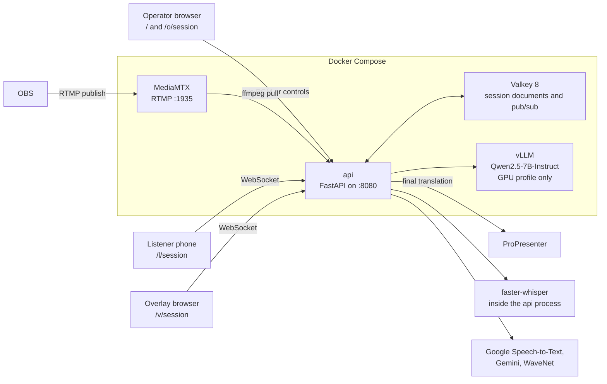
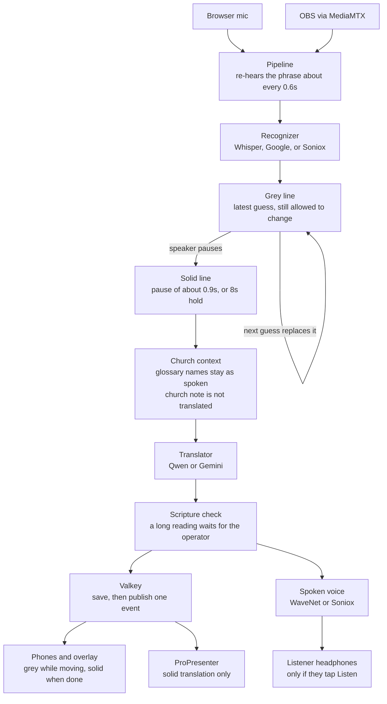
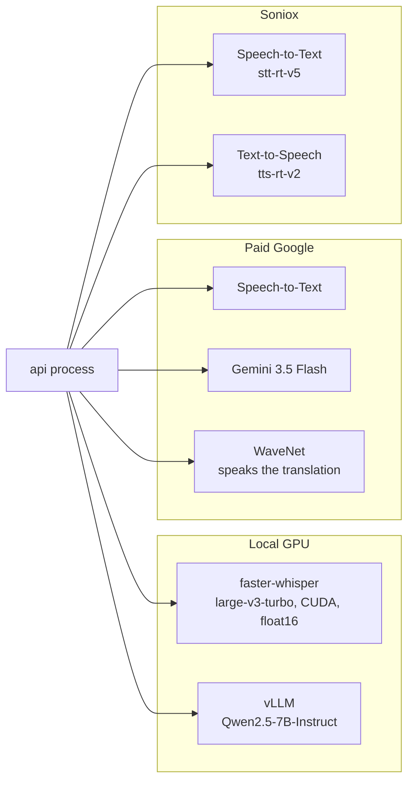

# voiceofgod structure

Self-hosted live captions for a sermon, English and Bahasa Indonesia. One Python process serves the pages, the API, and the caption pipeline. Speech and translation can run on a local GPU or through paid Google APIs. Listeners need no account.

## Runtime

The `translator` container exists only with `docker compose --profile gpu`. The Google path leaves `VLLM_BASE_URL` empty and does not need that GPU. MediaMTX always starts with Compose; the browser microphone is used when RTMP secrets are unset.

HTTPS sits in front of port 8080. Browsers will not open the microphone on plain HTTP, except on localhost. Port 1935 is separate: OBS reaches MediaMTX directly, not through the HTTPS proxy.

## Pages and sockets

| Path | Who | What |
| --- | --- | --- |
| `/` | Signed-in church | That church's services, newest first. |
| `/login` | Operator | Sign in. There is no public signup. |
| `/onboarding` | Signed-in user | Church name, names to keep, and the church note. |
| `/settings` | Signed-in church | Default language, speech recognition, spoken voice, and the church note. |
| `/admin` | Admin | Create, disable, and reset users. |
| `/o/{session}` | That church, or the `?k` secret | Start, stop, glossary, hide and restore, metrics, QR, exports. |
| `/l/{session}` | Listener | Captions, and Listen when voice is on. |
| `/v/{session}` | Overlay | Transparent captions for OBS or a ProPresenter web layer. |
| `/ws/operate/{session}` | That church, or query `k` | Audio in, control events out. |
| `/ws/listen/{session}` | Listener and overlay | Caption events. No token. |

Static files live in `app/static` (HTML, CSS, `captions.js`, `worklet.js`). There is no frontend build.

## One caption

The grey line is one caption that is still being heard. Each new transcript replaces it, including its translation. A pause of about 0.9 seconds, or an 8 second hold, turns that line solid. A solid line is not rewritten. A bad line can be hidden; a held scripture reading can be restored. Up to four sessions can be live. They share one recognizer and one translator.

Church context is the glossary plus the church's own notes. Glossary names, such as the church name, are masked before translation and written back unchanged. The church name, church note, service name, and service note go to the translator as background for the interpreter. That block is not part of the sentence and is not translated. The same glossary names are also given to the recognizer so it is more likely to hear them.

The spoken voice is Google WaveNet or Soniox text-to-speech. It is not part of hearing the pulpit. After a line is solid, and only when spoken translation is turned on, that voice reads the translation aloud as an MP3. The listener taps Listen and should use headphones so the pulpit microphone cannot hear that voice. Captions still publish if a clip fails. WaveNet needs the Google key. Soniox needs its own key. A local GPU path with neither key has no spoken voice.

## Process layout

`app/main.py` builds one FastAPI app:

- **Director** owns sessions, the operator token, and one `SessionPipeline` per live session. It also owns RTMP ingest and the ProPresenter stage.
- **SessionPipeline** turns PCM into caption lines.
- **Repository** is Valkey in production (`RedisRepository`) or an in-process stand-in when Redis is not required.
- **Recognizer** is `WhisperRecognizer`, `GoogleRecognizer`, `SonioxRecognizer`, or a scripted fake for tests. A new service uses the church's saved choice.
- **Translator** is `VllmTranslator`, `GeminiTranslator`, a glossary-only fake, or an explicit unavailable translator.
- **Speaker** is Google WaveNet, Soniox, or absent. A new service uses the church's saved voice.

On startup the director reloads sessions from Valkey. A restarted API comes back paused; Start continues, and listeners keep lines they already have.

## Two speech paths

Recognizer choice: each church picks Standard or Soniox on Settings. Standard is Speech-to-Text when a Google key and cloud project are set, and Whisper otherwise, unless fake models are allowed. Soniox stays off until `SONIOX_API_KEY` is set. Translator choice: a Gemini key wins, otherwise vLLM when `VLLM_BASE_URL` is set. The spoken voice is chosen the same way. Google WaveNet uses `en-US-Wavenet-D` for English and `id-ID-Wavenet-B` for Bahasa Indonesia. Soniox speaks with the configured voice. Captions still publish if a spoken clip fails. A service keeps the recognizer and voice it was created with.
